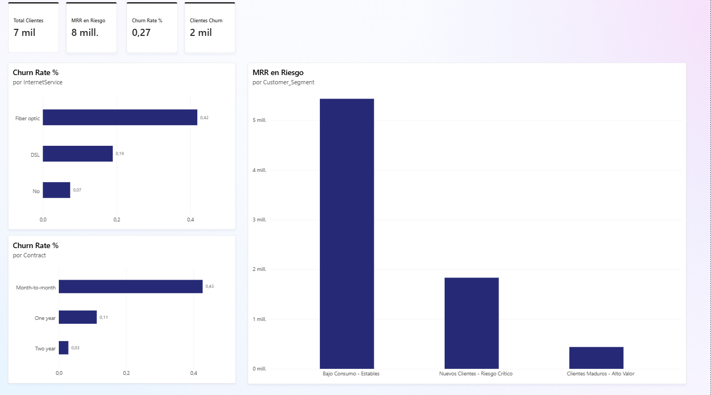

# Customer Churn & Behavioral Analytics (EDA, K-Means & Power BI)

Proyecto de analítica de clientes para identificar patrones de abandono (*customer churn*), cuantificar su impacto financiero y construir segmentos accionables para campañas de retención.

## Contexto y problema de negocio

En los negocios basados en suscripción, cada baja reduce los ingresos recurrentes mensuales y obliga a invertir nuevamente en adquisición para reemplazar al cliente perdido. Además del impacto directo en facturación, un churn elevado puede señalar fricciones en el onboarding, el servicio, los métodos de pago o la propuesta de valor.

Este proyecto analiza el comportamiento de clientes de telecomunicaciones para responder preguntas como:

- ¿Qué contratos, métodos de pago y cohortes de antigüedad presentan mayor riesgo?
- ¿Cuánto ingreso mensual se concentra en clientes que abandonan?
- ¿Qué perfiles de clientes pueden priorizarse en una estrategia de retención?

## Vista previa del dashboard



El archivo fuente del informe de Power BI se encuentra en [dashboard/churn_executive_overview.pbix](dashboard/churn_executive_overview.pbix).

## Stack tecnológico

- **Data Wrangling & EDA:** Python, Pandas, NumPy, Matplotlib y Seaborn.
- **SQL & Query Engine:** DuckDB.
- **Machine Learning / Segmentación:** Scikit-Learn, mediante K-Means Clustering.
- **Business Intelligence:** Power BI y DAX.

## Principales hallazgos

- El churn global del dataset es de **26,54%**.
- Los clientes con contrato **Month-to-month** presentan un churn de **42,71%** y concentran aproximadamente **$120.847,10** de MRR perdido.
- **Electronic check** es el método de pago con mayor churn (**45,29%**).
- La cohorte de **0-12 meses** alcanza un churn de **47,44%** y concentra el **55,48%** de los clientes que abandonaron.
- K-Means identifica un perfil de mayor riesgo con menor antigüedad y cargos mensuales relativamente altos: **13,25 meses** de antigüedad promedio, **$74,95** de cargo mensual y **47,08%** de churn.

## Estructura del proyecto

```text
.
├── data/
│   ├── raw/              # Dataset original y CSV de trabajo
│   └── processed/        # Dataset limpio para Power BI
├── dashboard/
│   ├── churn_executive_overview.pbix
│   └── dashboard_preview.png
├── notebooks/
│   ├── 01_tranforming_data_csv.ipynb
│   └── 02_eda_and_segmentation.ipynb
├── requirements.txt
└── README.md
```

## Instrucciones de ejecución

### 1. Clonar el repositorio

Reemplaza `<URL_DEL_REPOSITORIO>` por la URL del repositorio remoto:

```bash
git clone <URL_DEL_REPOSITORIO>
cd customer-churn-analytics
```

### 2. Crear y activar el entorno virtual

En Windows PowerShell:

```powershell
python -m venv .venv
.\.venv\Scripts\Activate.ps1
python -m pip install --upgrade pip
pip install pandas numpy matplotlib seaborn duckdb scikit-learn jupyter notebook openpyxl
```

En macOS o Linux:

```bash
python3 -m venv .venv
source .venv/bin/activate
python -m pip install --upgrade pip
pip install pandas numpy matplotlib seaborn duckdb scikit-learn jupyter notebook openpyxl
```

### 3. Ejecutar los notebooks

Desde la raíz del proyecto:

```bash
jupyter notebook
```

Ejecuta primero `notebooks/01_tranforming_data_csv.ipynb` si necesitas regenerar el CSV original y después `notebooks/02_eda_and_segmentation.ipynb` para realizar la limpieza, el EDA, la consulta DuckDB y la segmentación K-Means. El notebook exporta el resultado a `data/processed/telco_churn_enriched.csv`.

## Notas

Las rutas relativas de los notebooks están pensadas para ejecutarse desde la carpeta `notebooks/`. El archivo `.pbix` requiere Power BI Desktop para abrirse y explorar sus visualizaciones y medidas DAX.
